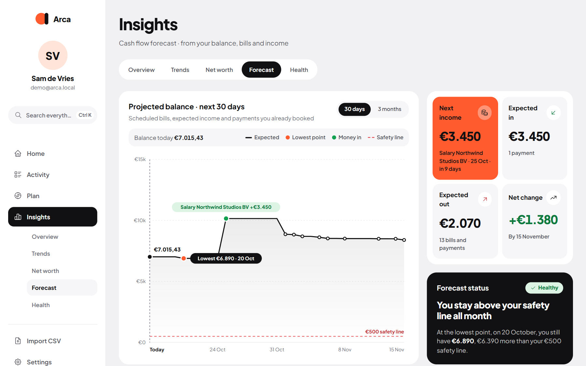

<p align="center">
  <picture>
    <source media="(prefers-color-scheme: dark)" srcset="src/app/logo_dark.svg">
    
  </picture>
</p>

<p align="center">
  <b>A calm, self-hosted personal finance app.</b><br>
  Know what's safe to spend, what's coming up, and where your money went, with your data on your own server.
</p>

<p align="center">
  <a href="https://github.com/damianeickhoff/Arca/releases/latest"></a>
  <a href="https://github.com/damianeickhoff/Arca/pkgs/container/arca"></a>
</p>

> **Work in progress.** Arca is actively developed and may get frequent updates and the occasional breaking change. Back up your `/data` folder before updating.

## 📸 Screenshots

<p align="center">
  <picture>
    <source media="(prefers-color-scheme: dark)" srcset="docs/screenshots/home-dark.png">
    
  </picture>
  <br><sub><b>Home</b>: what's safe to spend, this month's money in and out, and the budget at a glance</sub>
</p>

<table>
  <tr>
    <td width="50%"><br><sub><b>Activity</b>: every transaction, searchable and grouped by day</sub></td>
    <td width="50%"><br><sub><b>Plan</b>: the budget per category, with needs, wants and savings</sub></td>
  </tr>
  <tr>
    <td width="50%"><br><sub><b>Insights</b>: any period in numbers, categories and merchants</sub></td>
    <td width="50%"><br><sub><b>Forecast</b>: where your balance goes over the next 30 days</sub></td>
  </tr>
</table>

<p align="center">
  
  &nbsp;&nbsp;
  
  <br><sub>On your phone, in light and dark</sub>
</p>

<sub>Screenshots use the built-in demo data.</sub>

## ✨ Features

**See where you stand**
- **Home**: what's safe to spend today, what's coming up, money in versus out, and all your accounts at a glance.
- **Insights**: an overview of any period, trends per category and group, net worth over time, a financial health score, and a cash-flow **forecast** that warns before you run short.

**Keep track without the busywork**
- **CSV import** for ING, Rabobank, ABN AMRO, bunq, Knab and Revolut out of the box, plus a column mapper for any other bank (remembered for next time).
- **Needs a category**: sort uncategorised transactions one by one, and turn each answer into a rule so the list stays short.
- **Activity**: search, filters, bulk edits, split transactions, receipts, shared costs and transfers between your own accounts.
- **Merchants** with logos, friendly names and category groups (Housing, Transport, …).

**Plan ahead**
- **Budget**: an overall or per-category budget with a needs / wants / savings strategy.
- **Recurring**: bills, subscriptions, income and savings, matched to transactions automatically, with an **Upcoming** calendar.
- **Payment plans**: pay one cost in parts (the dentist in three instalments); each part counts in the month it's due.
- **Debts**: what you owe and what you're owed, with a payoff simulator.
- **Goals**: savings goals with contributions and suggestions.
- **Overdraft limits** per bank account; you choose whether the overdraft counts as money you can spend.

**Optional AI (Gemini, free tier)**
- Category suggestions in Needs a category, and a short written summary of any period on Insights.
- Off until you add your own API key. Only merchant names, amounts, dates and category names are sent, never account numbers.

**Yours**
- Self-hosted: one SQLite file in `/data`, no cloud account.
- Several users, two-factor sign-in, an app lock (PIN or passkey) and a privacy mode that hides amounts.
- Light and dark theme, English and Dutch, works on desktop and phone, installable as an app (PWA).

## 🚀 Getting started

### Docker

```bash
docker run -d \
  --name arca \
  -p 3000:3000 \
  -v /path/to/arca-data:/data \
  --restart unless-stopped \
  ghcr.io/damianeickhoff/arca:latest
```

Open `http://localhost:3000`. The first start creates the database and opens the onboarding.

### Docker Compose

```yaml
services:
  arca:
    image: ghcr.io/damianeickhoff/arca:latest
    container_name: arca
    ports:
      - "3000:3000"
    volumes:
      - ./data:/data
    environment:
      # Set to "true" only behind a reverse proxy that serves HTTPS.
      - COOKIE_SECURE=false
    restart: unless-stopped
```

### Unraid

Use the template in [`unraid/arca.xml`](unraid/arca.xml): copy it to
`/boot/config/plugins/dockerMan/templates-user/`, then **Docker → Add Container → Template → User templates → Arca**.
Map `/data` to `/mnt/user/appdata/arca`.

### Your data

Everything lives in `/data`: the SQLite database (`finance.db`) and uploaded logos and avatars. Back up that folder; nothing else needs to persist.

## 🔄 Updating

Images are published to the GitHub Container Registry:

| Tag | What it is |
| --- | --- |
| `latest` | The current release (the `master` branch) |
| `v1.3.0`, … | A specific release |
| `<branch>` | A test build of a branch, never `latest` |

```bash
docker pull ghcr.io/damianeickhoff/arca:latest
```

Then recreate the container, keeping `/data`. New database columns are added automatically on start. On Unraid, **Check for updates** in the Docker tab picks up a new `latest`.

## 🆘 Support

Issues and feature requests: <https://github.com/damianeickhoff/Arca/issues>

## 📄 License

Arca is distributed as a self-hosted application.
