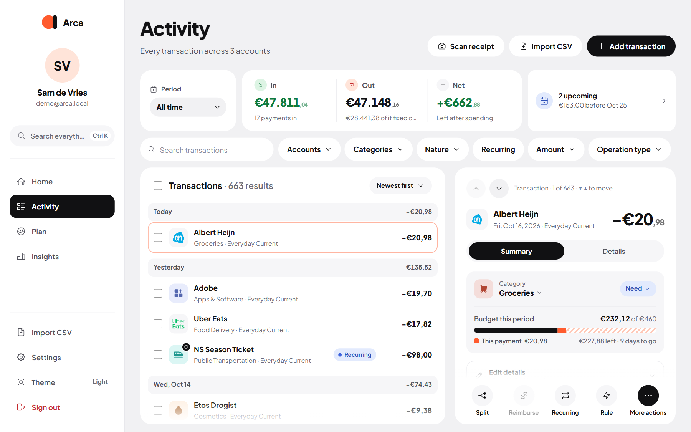

Activity lists every transaction across your accounts, grouped by day, newest first.

## Search

Type in **Search transactions** to filter the list as you type. Search looks at the description, the amount and the category name, and always searches **all dates**, whatever period you picked. On a phone the search bar sits at the bottom, within thumb reach.

To sort differently, use the sort menu: **Newest first**, **Oldest first**, **Highest amount** or **Lowest amount**.

## Filters

The chips above the list narrow it down. Tap a chip to set it, and the × to clear it.

| Chip | What it does |
| --- | --- |
| **Period** | All time, today, yesterday, this month, previous month, half a year, a year, or your own dates. Months follow your [financial month](/Arca/settings/preferences/#financial-month). |
| **Accounts** | One or more accounts. |
| **Categories** | One or more categories. |
| **Nature** | Needs, wants or savings. |
| **Recurring** | Only transactions that belong to a recurring item. |
| **Amount** | A minimum and/or maximum. |
| **Operation type** | Only income or only expenses. |

**Clear all filters** resets everything except the period. The summary card above the list shows **In**, **Out** and **Net** for whatever you've filtered.

## Select several at once

On a computer, tick the checkbox on a row. On a phone, press and hold a transaction. Then pick more (or a whole day) and choose:

- **Category**: give them all the same category.
- **Exclude** / **Include**: leave them out of reports and budgets, or bring them back.
- **Delete**: remove them (you're asked to confirm).

Press <kbd>Esc</kbd> or **Leave selection mode** when you're done.

## The detail panel

Open a transaction to see everything about it. On a computer it opens on the right; on a phone as a sheet. Use <kbd>↑</kbd> and <kbd>↓</kbd> to step through the list while it's open.

**Summary** shows the category, its budget type, what this payment did to the category's budget this period, and the merchant or recurring history. Tap the merchant's name for its profile. Under **Edit details** you can change the merchant, link a savings goal, write a note and add a receipt.

**Details** shows everything your bank sent along, such as the IBAN, the reference and the original bank line, with copy buttons.

### What you can do

- **Change the category.** Arca then offers to file this merchant the same way from now on. See [Rules and merchants](/Arca/transactions/rules-and-merchants/#teach-it-once).
- **Split** it into parts with their own category, by amount or by count.
- **Reimburse**: on money coming in (a Tikkie, a friend paying you back), link it to the expense it paid back.
- **Recurring**: turn it into a [recurring item](/Arca/plan/recurring/).
- **Rule**: create a rule for transactions like this one.

The **⋯** menu has the rest: correct the amount, change the merchant, pick a logo, add or remove a receipt, exclude from reports, mark as a reimbursement or as an internal transfer, look the shop up on Google, or delete the transaction.

:::tip[Who charged me?]
Don't recognise a charge? **Look up on Google** searches the shop name on the web in a new tab.
:::

## Shared costs

Paid a bill in full that others pay you back for, like dinner or the energy bill with a housemate? Open **Split** and switch on **Others pay me back for this**, then enter how many people share it (you included).

- Your cash flow always keeps the full charge: it really left your account.
- Reports can show only **your share** if you choose **Show my share** in Settings → Budget & bills. See [Preferences](/Arca/settings/preferences/#budget-and-bills).

When the money comes back, open the incoming payment and use **Reimburse** to link it.

## Correct amount

**Correct amount** changes what a transaction counts as in budgets and reports, without touching your bank balance. Handy for a deposit you got back, or a purchase that was partly for someone else. While you type, you see what it does to the category's budget. Leave it empty to remove the correction.

## Transfers between your own accounts

Moving money from your checking account to savings isn't spending. Arca recognises most of these by itself. If one slipped through, open it and choose **Mark as internal transfer** in the ⋯ menu. Internal transfers have no category and are left out of income, spending and budgets.

## Receipts

Use **Add receipt** in a transaction's details to attach a photo of the receipt. Open it again to zoom in or download it.

:::caution
Receipt photos are currently not part of your `/data` backup. See [Updating and backups](/Arca/getting-started/updating-and-backups/#back-up-your-data).
:::

**Scan receipt** (on Home and in Activity) works the other way round: take a photo first and Arca fills in the merchant, amount, date and a matching category for a new transaction. You check the details before saving. Scanning needs a local AI model (Ollama) that whoever runs your server [sets up](/Arca/getting-started/install/#settings-you-can-change); without it, just type the details.

## Add a transaction

Use **Add transaction** (or the [add menu](/Arca/everyday/add-and-search/)) for cash payments or anything your bank didn't send.

- Choose **Expense**, **Income** or **Transfer** (between two of your accounts).
- Type the amount with the keypad (or your keyboard's number keys). Switch on the calculator to add up amounts.
- **Today**, **Yesterday** and **Tomorrow** are one tap away.
- Pick a category to see what's left in its budget after this.
- **Save and add another** keeps the form open with the same date and account.
