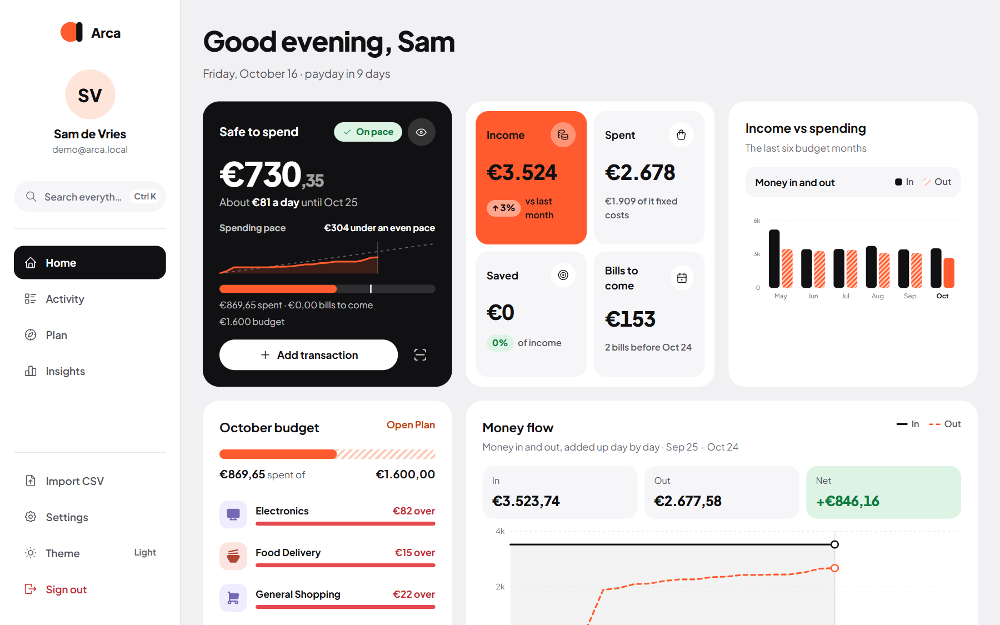
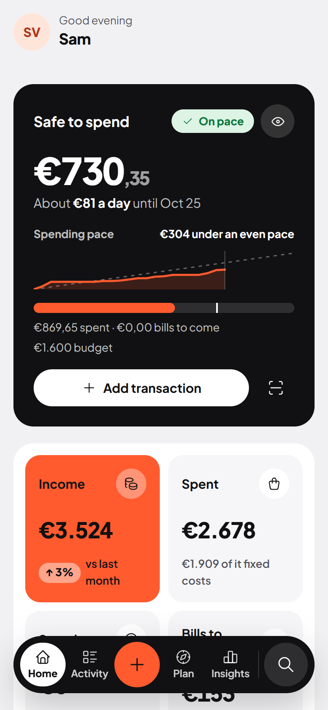
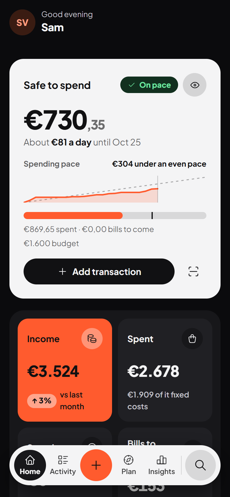

Home is the answer to "how am I doing?": one number at the top, the details underneath.

## Safe to spend

The black card at the top is **Safe to spend**: what you can still spend this period without going over your budget.

  
How it's worked out

  
Budget − spent so far − bills still to come

  
The line under the bar shows exactly that sum, for example "€640 spent · €310 bills to come".

- **Budget** is your overall budget, or the sum of your category budgets if you didn't set an overall one. See [Budget](/Arca/plan/budget/).
- **Spent so far** is what has gone out this period and counts towards the budget.
- **Bills still to come** are the unpaid bills due between today and the end of the period. Income is never subtracted.
- Under the number you see **About €… a day until …**: the amount spread over the days left.

A chip tells you how you're doing:

- **On pace**: you're spending at or below an even pace.
- **Spending fast**: what you've spent plus the bills you've reserved is clearly ahead of how far the period is.
- **Over budget**: there's nothing left to spend this period.

The **Spending pace** chart compares what you've spent with an even pace through the period.

:::tip[No budget yet?]
Safe to spend needs a budget. Until you set one, the card shows **Set a budget** and **Import CSV** buttons instead.
:::

The card also has **Add transaction** and a **Scan receipt** button, and an eye button that turns on [privacy mode](/Arca/settings/security/#privacy-mode).

## This month

Four tiles for the current period:

- **Income**, compared with last month.
- **Spent**, with how much of it was fixed costs.
- **Saved**: money that went into your savings categories, as a share of income.
- **Bills to come** before the end of the period, or "Nothing left to pay".

Transfers between your own accounts and money paid back to you are left out, so they don't count as income or spending.

## Income vs spending

The last six budget months side by side: money in as dark bars, money out striped. This month's spending is the orange bar.

## Budget

Your budget for this month (or week), how much is spent, and the four categories that have used the biggest share. **Open Plan** takes you to the full [budget](/Arca/plan/budget/). This card only shows once you have a budget.

## Money flow

Money in and money out this period, added up day by day. The gap between the two lines today is what you've kept so far.

## Coming up

The next unpaid bills and expected income this month, soonest first, with **Overdue**, **Today**, **Tomorrow** or "In 3 days". The link at the top opens [Upcoming](/Arca/everyday/upcoming/), where you can mark a bill as paid.

## Accounts

One balance per bank account and the total, which links to your [net worth](/Arca/insights/net-worth/). If an account may go below zero, you see how much of its overdraft you use. See [Accounts and assets](/Arca/settings/accounts/).

## Recent activity

Your last seven transactions with their category and a status such as **To review**, **Recurring**, **Internal transfer** or **Paid back**. **View all** opens [Activity](/Arca/everyday/activity/).

## Needs a category

When transactions are waiting for a category, a strip at the top says how many, with a **Review** button. See [Needs a category](/Arca/everyday/needs-a-category/).

## On your phone

The same cards, stacked. Your photo at the top opens Settings, and the bar at the bottom takes you to Activity, Plan and Insights, with the orange **+** in the middle.

