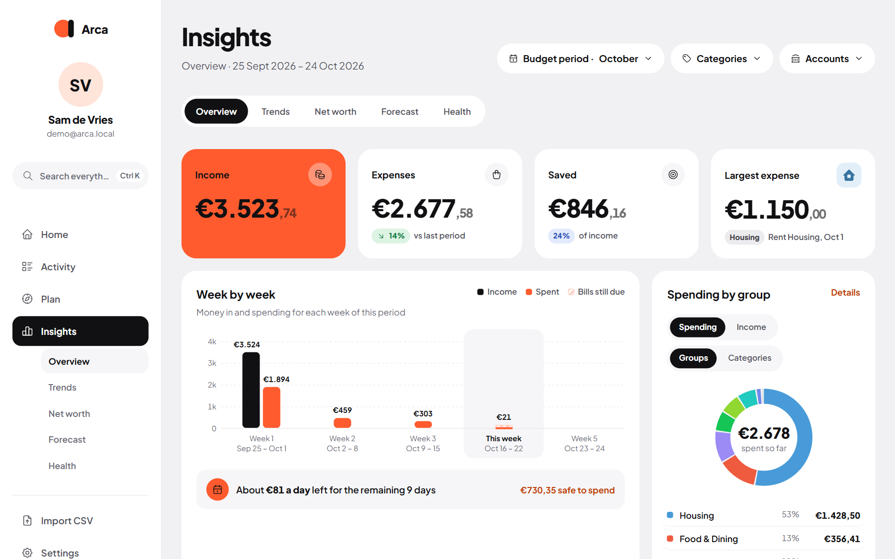

**Insights → Overview** answers "where did my money go?" for any period you pick.

Insights has five tabs: **Overview**, **Trends**, **Net worth**, **Forecast** and **Health**.

## Pick a period

The **Period** menu at the top: **Budget** (your budget month, payday to payday), **Week**, **Month**, **Last 3 months**, **Last 6 months**, **Year** or **Custom**. You can also filter on **Categories** and **Accounts**. Overview opens on your current budget period.

## The cards

- **Income**, **Expenses**, **Saved** (with the share of income) and your **Largest expense**.
- A chart of money in and out, day by day, week by week or month by month, depending on how long the period is.
- **Summary**: the period in three facts and what's left to spend per day (below).
- **Spending by group** or **by category**: switch between spending and income, and between [groups](/Arca/settings/categories/) (like everything for the house) and single categories. Money without a category shows as **Other**, with a link to sort it.
- **Top merchants**: where most of your money went, with the number of visits behind each total.
- **By account**: spending per account. Savings and transfers between your own accounts are left out.
- **Calendar**: a heatmap of your spending per day, with your average per day and your busiest day.

## Summary

The **Summary** card sums up the period in three facts and what's left to spend per day, worked out from the numbers on the page.

If you've switched on [AI](/Arca/settings/ai/), choose **Write with AI** and it writes those facts up in plain sentences with a budgeting tip. The numbers always come from Arca; the AI only writes the words.

:::tip[Not much to see yet?]
Insights needs a little history. Import a few months of transactions (see [CSV import](/Arca/transactions/csv-import/)) and the cards fill up.
:::
