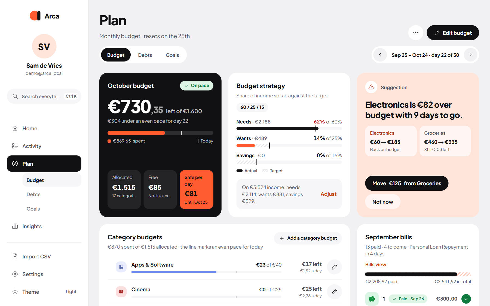

Your budget is what [Safe to spend](/Arca/everyday/home/#safe-to-spend) is built on. Set one overall limit, fine-tune it per category if you like, and Arca keeps track of your pace through the month.

You find it under **Plan → Budget**. The switch under the heading moves between **Budget**, **Debts** and **Goals**.

## Your overall budget

The overall budget is the most you want to spend in a period.

- Choose **Monthly** or **Weekly**. A monthly budget follows your [financial month](/Arca/settings/preferences/#financial-month) (usually payday to payday); a weekly one resets every Monday.
- **Edit budget** changes the amount; **Delete budget** removes it (and the category budgets with it).

:::tip
You don't need an overall budget. Without one, your category budgets together are the limit.
:::

## Category budgets

Choose **Add a category budget** to give a category its own limit, one at a time. At the top you see how much is **Allocated** to categories, what's **Free** (not in a category) and the **Bills to come**.

- Each category shows what it has spent this period and a mark for where an even pace would be today.
- Tap a category for where the money went, its pace and the last months. The pencil edits its budget.
- If your category budgets add up to more than the overall budget, Arca says so and offers to raise the overall budget.
- Spending in categories without their own budget is listed below, and comes out of the free money.

## Pace

Arca compares what you've spent with an even pace through the period:

- **On pace**: you're fine.
- **Spending fast**: you're ahead of where you'd expect to be by now.
- **Over budget**: the limit is reached.

You also see how much you're under or over an even pace, and what's safe to spend per day.

## Move budget in one tap

When a category runs hot, a **Suggestion** card offers to move budget from a category with room to spare, for example "Move €40 from Clothing". Your overall budget stays the same. **Not now** dismisses it.

## This month's bills

The bills section lists this budget month's bills: paid ones above the **Today** line, the ones still to come below it. A bill is ticked off by itself when it's paid, or you tick it off yourself. Whether bills also count against your category budgets is up to you: see [Budget & bills](/Arca/settings/preferences/#budget-and-bills).

## Look back

Use the arrows next to the dates to see how an earlier budget month ended: what you spent, which categories went over, and which bills were paid.

## Your strategy: needs, wants and savings

The **Budget strategy** splits your income into three parts:

- **Needs**: things you can't skip, like rent, groceries and insurance.
- **Wants**: everything that's nice but optional.
- **Savings**: what you put aside.

Common splits are **50 / 30 / 20**, **60 / 20 / 20** and **70 / 20 / 10**, or set your own (the three must add up to 100%). Choose **Adjust** to change it. Arca turns the split into an advised monthly budget, and shows each part's target (striped) next to what you actually spent or saved.

Which part a category belongs to is its **budget type**, set per category in [Categories and groups](/Arca/settings/categories/).
